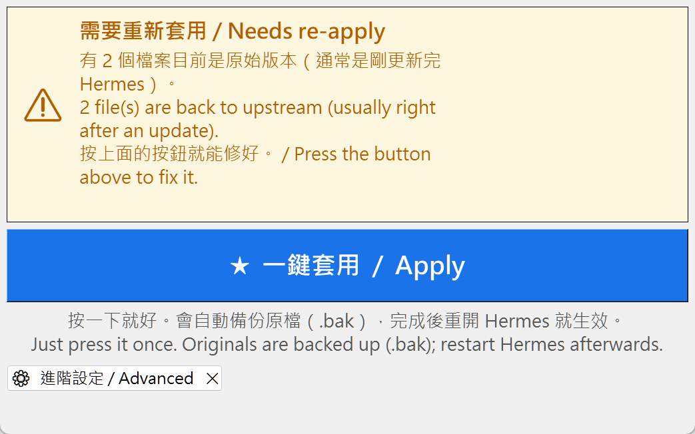
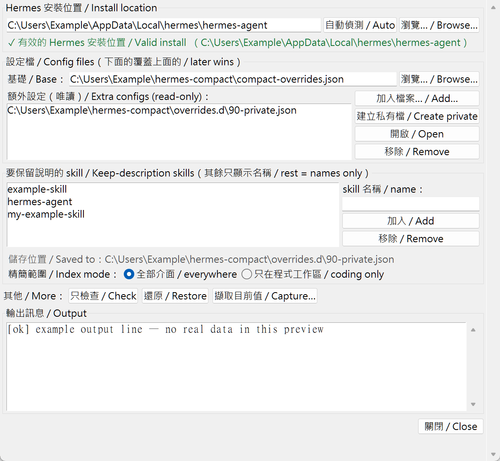

# hermes-lean

**一鍵把精簡後的工具描述與系統提示詞，在每次 `hermes update` 之後重新套用回 Hermes。**

**Re-apply your compact tool & system-prompt descriptions to Hermes with one click (or one command) after every `hermes update`.**

---

## 為什麼需要這個 / Why this exists

Hermes 送給模型的可讀文字很長：每個工具的 schema、好幾段系統提示詞區塊，都寫得鉅細靡遺。這些文字**每一次請求**都會重送，是長期且固定的 token 成本。精簡可降低成本，但必須保留語意並在每次更新後重新驗證；Hermes 的更新器也可能覆蓋手動修改。

Hermes ships long, verbose model-facing text: every tool schema and several system-prompt blocks are written out in full. That text is re-sent on **every** request, so it is a recurring token cost. Compaction can reduce that cost, but wording must preserve semantics and be re-verified after updates; Hermes updates may also overwrite manual edits.

本工具把你的精簡文字保存在**設定檔**，一個步驟重新套用。它不改寫記憶、使用者資料或任何機密；可選的唯讀記憶功能只在 Hermes 執行時讀取既有記憶，作為提示詞 context。

This tool keeps your compact wording in **config files** and re-applies it in one step. It never rewrites memory, the user profile, or secrets; optional read-only memory injection reads existing files at Hermes runtime for prompt context.

---

## 快速開始 / Quick start

### 圖形介面（最簡單，可處理自訂路徑）/ GUI (easiest, handles custom paths)

```
compact_ui.bat        # Windows：雙擊 / double-click
./compact_ui.sh       # macOS / Linux / Git-Bash
bash compact_ui.sh    # 若 .sh 沒有執行權限（例如用網頁上傳或下載 ZIP）就改用這個
```

視窗只有**一顆大按鈕**。打開時它會自動檢查，並用顏色告訴你現在的狀況：

The window has **one big button**. On open it checks automatically and uses colour to tell you the state:



| 狀態 / State | 意思 / Meaning | 你要做什麼 / What you do |
|---|---|---|
| ⚠️ **需要重新套用** | 剛更新完 Hermes，檔案被還原成原始版 | **按一下藍色大按鈕** |
| ⚠️ **Needs re-apply** | Hermes was just updated; files are back to upstream | **Press the big blue button** |
| ✅ **一切正常 / All good** | 精簡描述已經套用好了 | 不用做任何事 / nothing to do |
| ❌ **找不到 Hermes** | 安裝位置不對 | 打開「進階設定」選資料夾 |
| ❌ **Not found** | Wrong install path | Open Advanced and pick the folder |

按鈕下方會說明：**按一下就好，會自動備份 `.bak`，完成後要完整重開 Hermes 才生效。**
其他功能（檢查、還原、擷取、設定檔、skill 白名單、精簡範圍）都收在 **⚙ 進階設定 / Advanced** 裡，平常不用打開。

Below the button it says: **just press it once, originals are backed up as `.bak`; fully quit and relaunch Hermes to take effect.**
Everything else (check, restore, capture, config files, skill allowlist, index mode) lives in a separate **⚙ Advanced** window and normally stays closed.



> 「進階設定」會開在**另一個視窗**（主視窗保持精簡，不會被撐大或蓋住）。
> Advanced opens in its **own window** — the main window stays compact and is never resized or covered.

> 介面為**中英雙語**，並支援高 DPI（200% 縮放不模糊）。
> The UI is **bilingual (Chinese / English)** and is high-DPI aware (crisp at 200% scaling).

### 命令列 / Command line

```
python apply_compact.py --yes        # 套用（每個檔案先備份） / apply (backs up each file first)
python apply_compact.py --check      # 試跑：只報告，不寫入 / dry run: report only, write nothing
python apply_compact.py --restore    # 移除管理區塊 / remove the managed blocks
python apply_compact.py --capture captured.json   # 把目前值存成設定檔 / snapshot live values to a config
```

套用後請**完整關閉並重新開啟 Hermes**，新的程序才會載入新的描述。
（在同一個程序裡開新對話並不會生效——Hermes 的程序在啟動時就把這些檔案載入記憶體了。）

After applying, **fully quit and relaunch Hermes** so the new process loads the new descriptions.
(Starting a new chat inside the same running process is not enough — Hermes loads these files into memory at process start.)

### 測試 / Tests

不需安裝第三方測試套件：

```bash
python -m py_compile apply_compact.py compact_ui.py tests/test_security.py tests/test_ui_security.py
python -m unittest discover -s tests -v
```

No third-party test package is required. GitHub Actions runs this suite on Windows, macOS, and Linux.

---

## 它改了什麼 / What it edits

它在**四個檔案結尾**附加一段清楚標記、**自足**的區塊：

It appends one clearly-marked, **self-contained** block to the END of four files:

| 檔案 / File | 區塊控制的內容 / What the block controls |
|------|-------------------------|
| `<hermes-agent>/model_tools.py` | 送給模型的工具與參數描述 / Tool + parameter descriptions sent to the model |
| `<hermes-agent>/agent/prompt_builder.py` | 系統提示詞文案 + 精簡的 skill 索引 + 併成一行的 host 區塊 / System-prompt guidance strings + the lean skill index + the merged host block |
| `<hermes-agent>/agent/coding_context.py` | skill 索引的**閘門**（何時把分類降級為只留名稱）/ The skill-index *gate* (when to demote categories to names-only) |
| `<hermes-agent>/agent/system_prompt.py` | 渲染時才組出的動態片段：環境 profile 行、MEMORY／USER PROFILE 區塊外框（見 `compact_rewrites`）/ Render-time pieces: the ambient profile line and the MEMORY / USER PROFILE block framing (`compact_rewrites`) |

這段區塊是**純附加**（接在既有程式碼之後）且**自足**（自己重新宣告文案與自己的 skill 索引渲染器），所以就算更新把檔案主體還原成上游版本，它仍能獨立運作。上游的 `git pull` 改的是檔案主體、不是我們的尾端區塊，因此幾乎不會衝突。重複執行具**冪等性**：它會就地取代自己的區塊，且每個被改的檔案旁都會留下帶時間戳的 `.bak` 備份。

The block is **pure additive** (appended after the existing code) and **self-contained** (it re-asserts its own wording and its own skill-index renderer), so it keeps working even if an update reverts the file body to upstream. An upstream `git pull` edits the file body, not our tail, so conflicts are rare. Re-running is idempotent: it replaces its own block in place, and a timestamped `.bak` is made next to each edited file.

若找不到目標、產生的 Python 無法編譯，或套用後驗證失敗，工具會**以非零結束並回滾所有目標檔案**。寫入使用同目錄暫存檔與原子取代；備份名稱包含微秒且以排他模式建立。

驗證會檢查設定的每個工具／參數名稱在目前 Hermes 中確實存在。若某個名稱已上游改名或移除，該筆覆寫是無效的，工具會**失敗並回滾**，而不是靜默跳過——這也是偵測上游改名的機制。

驗證時整份設定是寫進暫存檔、由檢查行程自行讀取（不是塞進命令列），因此設定再大也不會撞上 Windows 約 32k 字元的命令列上限（覆寫成長到數百筆時就會遇到）。

If a target is missing, generated Python fails compilation, or post-apply verification fails, the tool **exits non-zero and rolls back every target file**. Writes use same-directory temporary files plus atomic replacement; backup names include microseconds and are created exclusively.

Verification also checks that every configured tool/parameter name still exists in Hermes. A renamed or removed name is a silent no-op, so the tool **fails and rolls back** instead of skipping it quietly — this is how upstream renames surface.

Verification hands the config to the checker through a temp file instead of the command line, so a config big enough to break the Windows ~32k command-line limit still verifies.

---

## 設定檔（共用基礎 + 私有額外）/ Config files (shared base + private extras)

設定檔**依此順序合併**（後者覆蓋前者；字典合併、清單取聯集、以 `_` 開頭的鍵視為註解）：

Configs are **merged in this order** (later wins; dicts merge, lists union, keys starting with `_` are comments):

1. `--config PATH` — 基礎檔（預設 `overrides/compact-overrides.json`）/ the base file
2. `overrides.d/*.json` — 依檔名排序的插入檔 / drop-in additions, sorted by name
3. `--add-config PATH` — 額外檔案，依給定順序 / extra files, in the order given

把**可公開**的文案放在基礎檔，把**私有**內容（你的 skill 白名單、個人化文案）放在 `overrides.d/` 底下。這樣基礎檔可以安全分享，私有部分則被 `.gitignore` 排除。

Put **publishable** wording in the base file and **private** additions (your skill allowlist, personal wording) in a file under `overrides.d/`. That way the base stays safe to share and the private bits are ignored by `.gitignore`.

設定檔格式 / A config is a JSON object:

```jsonc
{
  "tool_descriptions":                  { "clarify": "Ask for decisions or clarification; batch independent questions." },
  "parameter_descriptions":             { "terminal": { "command": "Shell command." } },
  "prompt_strings":                     { "TASK_COMPLETION_GUIDANCE": "…",
                                          "STEER_MARKER_OPEN": "…",
                                          "PLATFORM_HINTS__desktop": "…" },
  "compact_rewrites":                   { "profile_line": "…{root}…",
                                          "memory_block_compact": true,
                                          "host_line_template": "Host: {host} | Home: {home} | CWD: {cwd}" },
  "skill_description_exception_skills": ["hermes-agent", "systematic-debugging"],
  "skill_index_gate": "focus",          // 或 / or "focus_and_coding"
  "compact_tool_search_schemas": true   // 也精簡橋接路徑 / also compact the bridge path
}
```

從 `compact-overrides.example.json`（基礎）與 `overrides.d/90-private.example.json`（私有插入）開始。

Start from `compact-overrides.example.json` (base) and `overrides.d/90-private.example.json` (private drop-in).

### skill 索引 / The skill index

`skill_index_gate` 控制索引**何時**把分類降級為只留名稱：

`skill_index_gate` controls *when* the index demotes categories to names-only:

- `"focus"` — 只要 `agent.coding_context: focus`（所有介面）/ whenever focus is on (all surfaces).
- `"focus_and_coding"` — 只在程式工作區且為 focus（Hermes 預設）/ only inside a code workspace AND focus (Hermes' default).

`skill_index_categories`（選用）可覆寫被降級的分類清單；`null` 保留模組預設。圖形介面把它做成兩個單選鈕。

`skill_index_categories` (optional) overrides the demoted category list; `null` keeps the module default. The GUI exposes the gate as two radio buttons.

skill 索引依分類列出技能。預設**只顯示名稱**；只有列在 `skill_description_exception_skills` 的技能會保留說明。只留名稱的項目仍可運作，用 `skill_view(name)` 載入即可。

The skill index lists skills by category. By default it shows **names only**; only the skills named in `skill_description_exception_skills` keep their description. Names-only entries still work and load with `skill_view(name)`.

### 唯讀記憶 / Read-only memory

在插入設定檔（例如 `overrides.d/95-memory-readonly.json`）加入：

```json
{"memory_read_only": true}
```

套用後，Hermes 會讀取目前 agent 所屬 profile 的既有 `memories/USER.md` 與 `memories/MEMORY.md`，完整注入提示詞；即使 `memory.user_profile_enabled`／`memory.memory_enabled` 為 false 也可見，不使用原有字數預算截斷。缺少或空白檔案會略過，不建立檔案。內容在 agent 第一次組提示詞時凍結；手動修改檔案後要開新對話才會載入新內容，以維持提示詞快取。

同時，內建 `memory` 工具不再被選入主工具與橋接 schema，直接呼叫其入口也會被拒絕，不寫入亦不建立待審提案。提示詞要求模型不得用檔案、terminal 或其他工具改寫這兩個檔案。套用驗證只使用暫存的合成記憶，不讀寫你的真實記憶。

**這是 agent 層級保護，不是作業系統鎖。** 通用 `terminal`／檔案工具仍具原本的檔案系統權限；惡意或不遵守提示詞的模型仍可能繞過。若要強制不可寫，請另用隔離帳號、沙箱或 Windows ACL；本工具不改這些權限。外部記憶 provider 不受此選項管制。功能預設關閉；本機插入檔可啟用，設為 false 並重新套用可關閉。

**可信檔案前提：** 此模式直接讀取全文，不經過上游 `MemoryStore.load_from_disk()` 的威脅掃描。只應用於你自行維護、確認可信的記憶檔案；不要把外部下載或未審核內容當作記憶注入。

Trust assumption: this full-text reader bypasses upstream `MemoryStore.load_from_disk()` threat scanning. Use only personally maintained, reviewed memory files; do not inject unreviewed third-party content.

Enable `memory_read_only: true` in a drop-in to inject full existing USER.md/MEMORY.md contents from the agent's own profile, even with the built-in memory flags disabled. Each agent freezes its snapshot on first prompt construction. Missing/blank files are skipped; no files are created. Built-in memory tool selection and its write entry point are blocked. This is **not a filesystem security boundary**: generic file/shell tools retain their permissions. Use an isolated account, sandbox or OS ACL for mandatory write protection. External memory providers are unaffected. Verification uses synthetic temporary files only.

### 精簡規則範例 / Slim rules example

`overrides.d/95-prompt-slim.example.json` 是**可選**的規則瘦身層：移除沒有觸發條件的常駐祈使句（`# Parallel`、`# Tool use`、`# Execution discipline` 的八條紀律），只留四行**各有明確觸發點**的規則（不編造／宣稱完成前先驗證並回讀寫入／引用原文不潤稿／破壞性動作前先講），並壓縮身份、mid-turn steering 與 skills 三段。疊在範例基礎檔之上，**再省 1,196 字元／請求**。

`overrides.d/95-prompt-slim.example.json` is an **optional** rule-slimming layer: it removes the always-on imperatives that carry no trigger condition (`# Parallel`, `# Tool use`, the eight `# Execution discipline` tags), keeps four lines that each fire on an explicit trigger (never fabricate / verify + read back before claiming done / quote text verbatim / announce destructive actions), and compresses the identity, mid-turn-steering and skills blocks. Layered on the example base config it saves a further **1,196 characters per request**.

啟用：把它複製或改名成 `overrides.d/95-prompt-slim.json`（或用 `--add-config` 指定），重新套用。退回：把檔名改掉或刪除，重新套用。

Enable: copy or rename it to `overrides.d/95-prompt-slim.json` (or pass it with `--add-config`), then re-apply. Revert: rename or delete it, then re-apply.

實測依據：以**前沿模型**的短探針比較完整版與精簡版（純文字 32 次＋帶工具 24 次、6 個任務），正確率、誠實度與識別碼保留沒有可觀測差異；而完整版的常駐祈使句反而助長**無界重試**。若你跑的是較弱或較便宜的模型，或流程沒有真人複核，**請不要啟用這個範例**——那些條文正是為這種情況寫的。

Measured basis: on frontier models a short probe suite (32 text-only calls + 24 tool-loop runs over 6 missions) showed no observable difference in accuracy, honesty, or identifier preservation, while the always-on imperatives did encourage unbounded retrying. If you run a weaker or cheaper model, or your pipeline has no human review, **do not enable this example** — those blocks exist for exactly that case.

### 動態提示詞區塊 / Dynamic prompt rewrites

`compact_rewrites` 處理**渲染時才組出來**的提示詞片段（純文字覆寫的 `prompt_strings` 碰不到它們）：

`compact_rewrites` handles prompt pieces that are **assembled at render time**, which the plain-text `prompt_strings` cannot reach:

| 鍵 / Key | 作用 / Effect | 位置 / Site |
|------|------|------|
| `profile_line` | 縮短環境 profile 行（`{root}` 於渲染時填入）/ rewords the ambient "Active Hermes profile" line (`{root}` filled at render time) | `agent/system_prompt.py` |
| `memory_block_compact` | 移除 MEMORY／USER PROFILE 區塊上下的 `═` 框線；**標題行原樣保留**，因此區塊偵測不受影響 / drops the `═` rule lines around each block; the header line stays verbatim, so block detection is unaffected | `agent/system_prompt.py` |
| `host_line_template`、`host_note` | 把逐行標籤的 host 區塊（`Host:` / `User home directory:` / `Current working directory:` / `Note:`）併成一行 / merges the label-per-line host block into one line | `agent/prompt_builder.py` |

三者都是**包裝式**改寫：先呼叫上游函式，成功才改寫它的輸出；一旦上游換了格式（找不到預期字串），就**原樣回傳**，不崩潰也不亂改。套用後的驗證會**在生產路徑上實際呼叫**這些函式並比對輸出（不是只比對模組常數），所以「設了卻沒生效」會讓套用失敗並回滾，而不是靜默假通過。

All three are **wrapper-style** rewrites: the upstream function runs first and its output is reworded only when the expected shape is found; otherwise the original text passes through untouched. Post-apply verification **calls these functions on the production path** and compares the output (not just module constants), so a rewrite that is configured but not actually live fails the apply and rolls back instead of passing silently.

### 橋接路徑的工具描述 / Tool descriptions on the bridge path

`compact_tool_search_schemas`（預設關）決定要不要連**不進主提示詞的 schema** 也一起精簡：Hermes 的旁路（`skip_tool_search_assembly=True`）會回傳**未精簡**原文，用於 `tool_describe`／`tool_call` 回覆、失敗呼叫的 schema 回吐、`hermes tools` 與桌面工具檢視器。

未開啟時，主提示詞已生效的精簡（如 `terminal` 47 字元）到那條路徑會變回上游 1,494 字元；開啟後同一份精簡字串也套用到該路徑，且套用後驗證會**實際探測該路徑**（設了沒生效就失敗回滾）。

`compact_tool_search_schemas` (default off) also compacts the schemas that never reach the main prompt: Hermes' side path (`skip_tool_search_assembly=True`) returns the **uncompacted** originals for `tool_describe`/`tool_call` replies, the failed-call schema dump, `hermes tools`, and the desktop tool inspector. Off, an override live in the prompt (e.g. `terminal`, 47 chars) still shows the 1,494-char upstream text there; on, the same compact strings apply, and verification probes that path.

---

## 找不到你的 checkout？/ Finding your checkout

圖形介面會自動偵測 `$HERMES_HOME/hermes-agent`（或平台預設：Windows 為 `%LOCALAPPDATA%\hermes\hermes-agent`，其他平台為 `~/.hermes/hermes-agent`）。如果你的位置不同，用「瀏覽」選到含 `model_tools.py` 的資料夾，或在命令列加 `--hermes-root <path>`。

The GUI auto-detects `$HERMES_HOME/hermes-agent` (or the platform default: `%LOCALAPPDATA%\hermes\hermes-agent` on Windows, `~/.hermes/hermes-agent` elsewhere). If yours lives elsewhere, Browse to the folder that contains `model_tools.py`, or pass `--hermes-root <path>` on the command line.

---

## 安全邊界 / Security boundary

- 只對**你信任的 Hermes checkout** 執行套用或擷取。套用後驗證與擷取會載入該 checkout 的 Python 模組；這和執行 checkout 本身具有相同的信任需求。
- GUI 的自動檢查使用啟動 GUI 的目前 Python，不會因你選了某個資料夾就執行該資料夾內的 `venv`。
- 工具拒絕目標檔案或路徑元件中的 symlink／Windows reparse point，設定檔也會經過嚴格 schema 驗證。
- GUI 匯入的額外 JSON 是唯讀輸入；白名單與模式只寫入被 Git 忽略的 `overrides.d/90-private.json`。

- Apply or capture only against a **Hermes checkout you trust**. Post-apply verification and capture import Python modules from that checkout, which has the same trust requirement as running the checkout itself.
- GUI auto-check uses the interpreter that launched the GUI; selecting a directory never makes auto-check execute that directory's `venv`.
- Target symlinks/Windows reparse points are rejected, and configs receive strict schema validation.
- Extra JSON files imported in the GUI are read-only inputs; allowlist and mode edits only write the Git-ignored `overrides.d/90-private.json`.

---

## 隱私 / Privacy

共用腳本與 `*.example.json` 不含機密、真實本機路徑或個人專用 skill 名稱；範例可能列出公開通用 skill 名稱。你真正的 `overrides/`、`overrides.d/*.json`、UI 狀態、擷取輸出與 `.bak` 已被 Git 忽略。本工具不改寫 Hermes 的記憶或使用者設定檔；可選的唯讀注入功能會在執行時讀取記憶。

The shared scripts and `*.example.json` contain no secrets, real local paths, or personal/private skill names; examples may name public generic skills. Real `overrides/`, `overrides.d/*.json`, UI state, captures, and `.bak` files are Git-ignored. The tool does not rewrite Hermes memory or the user profile; optional read-only injection reads memory at runtime.


---

## 檔案 / Files

```
apply_compact.py                 core tool (apply / check / restore / capture)
compact_ui.py                    GUI front-end (no third-party deps)
compact_ui.bat / .sh             GUI launchers
apply_compact.bat / .sh          CLI launchers
compact-overrides.example.json   publishable base example
overrides.d/90-private.example.json   publishable private-drop-in example
overrides.d/95-prompt-slim.example.json  optional slim-rule example (opt-in)
tests/test_publish_safety.py     commit-hygiene tests (local paths, ignored files)
overrides/compact-overrides.json      YOUR base config        (git-ignored)
overrides.d/*.json                    YOUR private configs    (git-ignored)
tests/                                security regression tests
SECURITY.md                           trust boundary + reporting policy
LICENSE                               MIT license
NOTICE                                third-party attribution (Hermes Agent)
```
